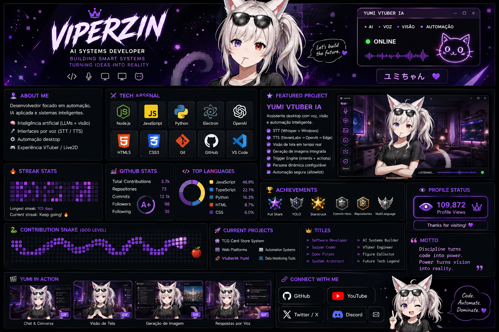
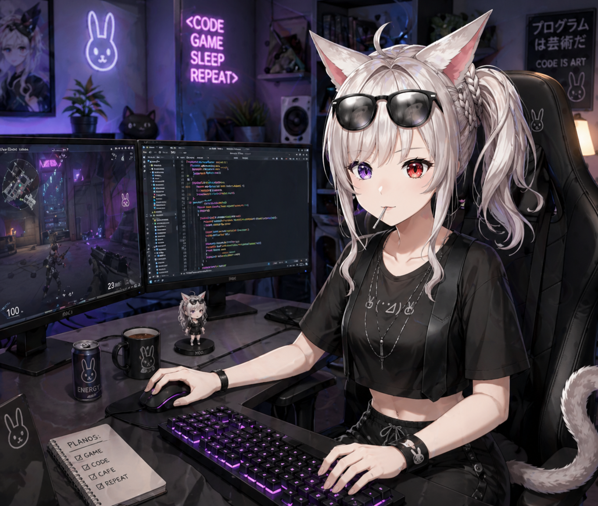

<h1 align="center">⛩️ Viperzin</h1>

<p align="center">
  
</p>

<p align="center">
  
</p>

<p align="center">
  <strong>Software Developer</strong>　·　<strong>AI & Automation</strong>　·　<strong>Figure Collector</strong>
</p>

<p align="center">
  <code>東京のネオンに着想を得て、コードでアイデアを形にする。</code>
</p>

---

## 🏮 Sobre mim

Desenvolvedor com interesse em **automação, inteligência artificial e sistemas criativos**. Gosto de transformar ideias em ferramentas úteis, combinando tecnologia com referências de games, anime e cultura japonesa.

- 🤖 Inteligência artificial e interfaces por voz
- ⚙️ Automação desktop e sistemas inteligentes
- 🎙️ VTubers, Live2D e experiências interativas
- 🎮 Games, colecionáveis e cultura pop japonesa

---

## ⚔️ Arsenal tecnológico

<p align="center">
  
  
  
  
  
  
  
  
  
</p>

---

## 🌸 Yumi em ação

<p align="center">
  
</p>

---

## 🎮 Projetos em andamento

| Projeto | Descrição |
| --- | --- |
| 🤖 **VTuberIA Yumi** | IA, voz e automação em uma experiência interativa |
| 🛒 **TCG Card Store System** | Sistema para loja de cards colecionáveis |
| 🌐 **Web Platforms** | Plataformas e aplicações web |
| ⚙️ **Automation Systems** | Ferramentas para automatizar tarefas |
| 📊 **Data Monitoring Tools** | Monitoramento e visualização de dados |

---

## 📈 Atividade no GitHub

<p align="center">
  
</p>

<p align="center">
  <a href="https://github.com/V1perzin?tab=repositories">
    🎮 Ver meus repositórios
  </a>
  &nbsp;·&nbsp;
  <a href="https://github.com/V1perzin?tab=stars">
    ⭐ Ver projetos salvos
  </a>
</p>

---

## 🐍 Mapa de contribuições

<p align="center">
  
</p>

---

## 🥷 Codename

```text
+ Software Developer
+ AI & Automation Builder
+ VTuber Engineer
+ Game and Anime Enthusiast
+ Figure Collector
